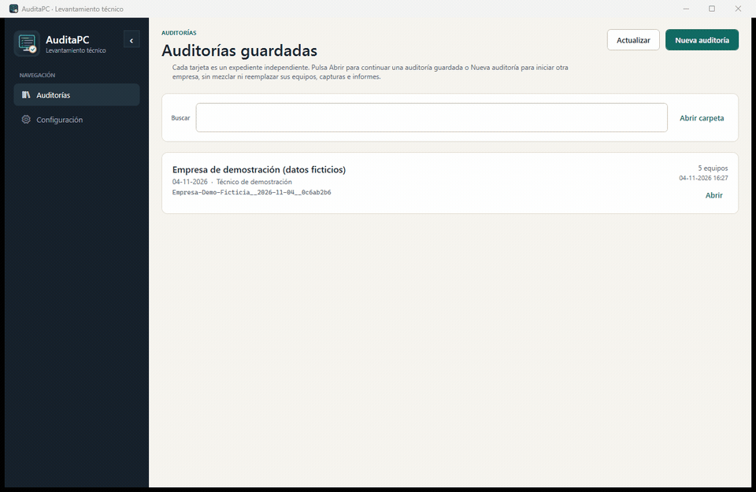

# AuditaPC

**Levantamiento técnico e inventario local de equipos Windows.**

AuditaPC es una aplicación de escritorio portable para técnicos que realizan levantamientos presenciales de equipos y documentan las condiciones de una visita. Cada auditoría pertenece a una empresa y fecha; se pueden agregar equipos en distintas sesiones, mantener el historial, registrar notas de terreno y generar informes para revisión.



*Captura real de la aplicación con una auditoría de demostración generada con datos ficticios. No corresponde a un cliente ni a un equipo real.*

> **Estado:** versión estable `1.0.0`. Aplicación portable para Windows x64, probada desde USB FAT32, exFAT y NTFS, con cuentas estándar y de administrador. Las 62 pruebas automatizadas y la compilación Windows CI están aprobadas.

## Objetivo y límites

AuditaPC consulta y documenta. No administra equipos.

**Incluye**
- Identificación del equipo, fabricante, modelo, serie y datos de firmware.
- Windows: edición, versión, compilación, instalación y estado local de activación cuando sea verificable.
- CPU, RAM, unidades físicas y volúmenes, espacio libre/ocupado y salud informada por Windows.
- Adaptadores y configuración de red local.
- Software detectado en los ámbitos consultables.
- Microsoft Office: productos, versiones, canal y estado de licencia local cuando el sistema lo permite.
- Comprobaciones no invasivas de antivirus, Defender, firewall, BitLocker, TPM y Secure Boot.
- Auditorías por empresa y fecha, actualización de fichas e historial de capturas.
- Notas de terreno por auditoría: resumen de visita, conectividad, módulos, estado, hallazgos, acciones, limitaciones y otras observaciones libres.
- Datos manuales por equipo, intervenciones, observaciones y fotografías.
- Ventana independiente para programas instalados, con búsqueda por nombre, editor, versión, fecha y ámbito.
- Informes HTML individuales y consolidados con búsqueda local por contenido, filtros de fichas e impresión/guardado en PDF desde el navegador; además de exportaciones CSV y JSON.

**Fuera de alcance**
- Instalar o desinstalar software.
- Administración remota o escaneo de otros computadores.
- Modificar la configuración del sistema.
- Reparaciones automáticas, monitoreo permanente o pruebas de rendimiento/estrés.
- Envío de inventarios, telemetría, sincronización en nube o dependencia de un servidor. La única comunicación opcional son comprobaciones HTTPS de conectividad con servicios de activación de Microsoft para Windows y Office.

## Flujo de trabajo

1. Abrir AuditaPC. En el catálogo, pulsar **Nueva auditoría** para crear un expediente o **Abrir** en una tarjeta para continuar uno existente.
2. Para otra empresa, pulsar **Nueva auditoría** incluso desde una auditoría abierta. AuditaPC solicita guardar o descartar los cambios manuales pendientes antes de cambiar de expediente.
3. Indicar la empresa, el técnico, la fecha y las notas iniciales. Cada creación obtiene una carpeta e identificador únicos; no modifica expedientes anteriores.
4. Confirmar en la cabecera el nombre de la empresa y el ID corto de la auditoría activa.
5. Conectar el pendrive al computador que se va a inventariar.
6. Ejecutar la captura y revisar el resultado por categorías.
7. Guardar el equipo; retirar el pendrive de forma segura.
8. Repetir en los demás equipos y continuar la misma auditoría.
9. Si se vuelve a inventariar un equipo, revisar la coincidencia antes de actualizarlo; las capturas anteriores se conservan.
10. Generar los informes. La ventana de resultados identifica la empresa, fecha, ID y número de equipos; los nombres de archivo también incluyen la empresa y el ID de auditoría.

La carpeta de auditorías predeterminada es `Auditorias`, directamente junto al ejecutable portable. El técnico puede cambiar su ubicación desde Configuración; las rutas dentro de la carpeta de la aplicación se guardan relativas para que el pendrive pueda cambiar de letra de unidad. Si la carpeta del ejecutable no permite escritura, AuditaPC avisa y utiliza el perfil local de Windows; en ese caso deja de ser portable hasta elegir una ubicación escribible.

**La captura se guarda solamente al confirmar «Guardar captura»** después de revisar los resultados y la coincidencia del equipo. Los informes ya generados no se actualizan automáticamente: vuelve a generarlos si modificas los registros.

## Caso de uso comprobado

Las pruebas de campo confirmaron el funcionamiento portable desde unidades USB con sistemas de archivos **FAT32, exFAT y NTFS**, tanto con permisos de usuario estándar como ejecutando con privilegios de administrador. Se comprobó la captura de información del equipo y la persistencia local para el flujo de inventario.

La herramienta guarda los datos localmente y no envía inventarios a servidores de terceros. Los registros e informes de equipos reales permanecen fuera del repositorio; la demostración pública utiliza datos ficticios.

La captura funciona localmente y sin conexión por defecto. No se envían inventarios a servidores de terceros; la comprobación HTTPS opcional de conectividad con servicios de Microsoft está desactivada por defecto y no transmite claves ni inventarios.

## Resultados y estados

AuditaPC distingue información verificada, detectada, no detectada, problemática, parcial, no verificable, que requiere administrador, acceso denegado, no evaluada por falta de conexión, limitaciones conocidas, no aplicable, error y tiempo agotado. Cada consulta incompleta debe explicar qué faltó y por qué. Las comprobaciones en línea desactivadas y las limitaciones conocidas no se contabilizan como fallos de captura.

La activación local de Windows u Office se consulta sin Internet cuando el proveedor está disponible: Windows mediante WMI y Office mediante WMI o la herramienta local `OSPP.VBS /dstatus` (sin leer ni guardar claves de producto). Configuración ofrece una opción desactivada por defecto para comprobar conectividad HTTPS con los servicios oficiales de activación de Microsoft, limitada a Windows y Office. Una respuesta del servicio no acredita titularidad ni vigencia contractual; Microsoft 365 requiere autenticación o revisión del portal correspondiente.

La disponibilidad de BitLocker, TPM, Secure Boot, salud de discos y otros datos depende del hardware, proveedor WMI, versión de Windows y permisos de la sesión. En particular, Win32_Tpm expone valores iniciales de habilitación/activación, no una prueba concluyente de que el TPM esté listo o operativo. El informe conserva estas limitaciones.

## Descarga portable (GitHub Releases)

Descarga **[AuditaPC-win-x64-portable.zip](https://github.com/jmorgadodev/AuditaPC/releases/latest/download/AuditaPC-win-x64-portable.zip)** desde GitHub Releases. Incluye el ejecutable autocontenido, instrucciones, la licencia MIT y una carpeta `Auditorias` vacía. No contiene registros ni informes de las pruebas.

Verifica el archivo con el [checksum SHA-256](https://github.com/jmorgadodev/AuditaPC/releases/latest/download/AuditaPC-win-x64-portable.zip.sha256). Versión estable: **1.0.0**.

### Descarga y ejecución en una línea (PowerShell)

```powershell
$u='https://github.com/jmorgadodev/AuditaPC/releases/latest/download/AuditaPC-win-x64-portable.zip';$z="$env:TEMP\AuditaPC.zip";$d="$env:LOCALAPPDATA\Programs";Invoke-WebRequest -Uri $u -OutFile $z;Expand-Archive -LiteralPath $z -DestinationPath $d -Force;Start-Process "$d\AuditaPC\AuditaPC.exe"
```

Este comando descarga y extrae la versión estable portable en el perfil del usuario; no instala un servicio ni modifica Windows.

Consulta la [guía de uso](docs/GUIA_USO.md), las [preguntas frecuentes](docs/FAQ.md) y el [procedimiento de publicación](docs/PUBLICACION_GITHUB.md).

## Requisitos

### Para utilizar la versión publicada
- Windows 10 u 11 de 64 bits.
- Ejecutable autocontenido publicado para `win-x64`; no requiere instalar .NET en el equipo auditado.
- Pendrive o carpeta local con permisos de escritura para mantener los datos junto a la aplicación.
- No requiere Internet ni privilegios de administrador para iniciar o realizar el levantamiento local.
- Algunas consultas requieren permisos elevados y se identifican como tales.
- La comprobación HTTPS de servicios de activación de Windows y Office es opcional y está desactivada por defecto; no realiza activaciones ni cambios de licencia.

### Para desarrollar
- Windows x64.
- .NET 10 SDK.
- Acceso a NuGet para restaurar paquetes.
- Git y un editor/IDE compatible con .NET y WPF.

## Compilar, probar y publicar localmente

Desde la raíz del repositorio:

```powershell
dotnet restore .\AuditaPC.sln
dotnet test .\AuditaPC.sln -c Release --no-restore
dotnet build .\AuditaPC.sln -c Release --no-restore
dotnet publish .\src\AuditaPC.App\AuditaPC.App.csproj -c Release -p:PublishProfile=PortableWinX64
```

El perfil `PortableWinX64` publica una aplicación autocontenida, de un solo archivo, para Windows x64 en:

`artifacts/publish/win-x64/AuditaPC.exe`

No se habilita trimming porque WPF, WMI y las consultas basadas en reflexión deben conservar sus dependencias. Las bibliotecas nativas necesarias pueden extraerse temporalmente al ejecutar el archivo. El release distribuye solo un ZIP con el EXE portable, `LEEME.txt` y `Auditorias/` vacía. El flujo automatizado está en `.github/workflows/release.yml` y requiere una licencia previamente aprobada.

### Regenerar la auditoría demostrativa

El generador usa exclusivamente datos ficticios y reemplaza la carpeta de ejemplo solo cuando encuentra su marcador de seguridad:

```powershell
dotnet run --project .\tools\AuditaPC.ExampleBuilder\AuditaPC.ExampleBuilder.csproj -c Release -- .\examples\auditoria-ficticia
```

La salida incluye cinco equipos ficticios (cuatro con captura y una ficha manual), historial, fotografía de ejemplo, notas de terreno e informes HTML individuales/consolidados, CSV y JSON. No consulta el computador real.

## Estructura del repositorio

- `src/AuditaPC.App/`: interfaz de escritorio WPF.
- `src/AuditaPC.Core/`: modelos, consultas, almacenamiento, coincidencia de equipos y reportes.
- `tests/`: pruebas automatizadas.
- `tools/AuditaPC.ExampleBuilder/`: generador de auditoría ficticia.
- `docs/`: alcance, arquitectura, decisiones, pruebas y seguridad.
- `src/AuditaPC.App/Assets/`: icono e identidad visual de la aplicación.
- `examples/`: instrucciones para **generar localmente** una auditoría demostrativa totalmente ficticia; los resultados JSON, HTML y fotos generados están excluidos de Git.
- `legacy/v1/`: archivos BAT/PowerShell de la herramienta anterior, conservados como referencia histórica y no usados en el ejecutable portable.
- `packaging/LEEME.txt`: instrucciones incluidas en el ZIP portable.
- `.github/workflows/`: integración continua en Windows y receta de publicación de GitHub Releases mediante un tag autorizado.

## Seguridad y privacidad

- No recopila contraseñas, claves de recuperación ni claves completas de producto.
- No administra equipos remotos ni escanea la red. Por defecto no transmite datos; si el técnico habilita la comprobación opcional, realiza únicamente solicitudes HTTPS a endpoints oficiales de activación de Microsoft para Windows y Office.
- Las fotos se guardan dentro de la auditoría; formatos admitidos: JPG, PNG, BMP, GIF y TIFF. Límite actual: 40 MB por archivo y 60 millones de píxeles.
- La comprobación en línea no ejecuta `slmgr /ato`, no inicia sesión, no envía claves de producto y no confirma titularidad ni vigencia contractual.
- Las exportaciones CSV neutralizan valores que podrían interpretarse como fórmulas.
- Las rutas de fotografías se validan antes de abrirlas o incrustarlas en informes.
- El `.gitignore` excluye ubicaciones y patrones comunes de datos de auditoría, pero no sustituye una revisión manual antes de publicar.

**Nunca incluir en GitHub auditorías reales, datos de clientes, capturas de pantalla de equipos reales, fotografías, nombres de usuario, direcciones IP internas o números de serie.** Los ejemplos del repositorio deben ser ficticios.

## Licencias

La documentación se publica bajo [Creative Commons Attribution 4.0 International (CC BY 4.0)](LICENSE-DOCS.md). Puedes reutilizar y adaptar los documentos con atribución.

**El código fuente y el ejecutable se distribuyen bajo MIT.** La documentación se distribuye separadamente bajo CC BY 4.0. Consulta [las licencias](docs/LICENCIAS.md) y los avisos de dependencias de terceros.

## Documentación

- [Índice de documentación](docs/README.md)
- [Guía de uso del portable](docs/GUIA_USO.md)
- [Preguntas frecuentes](docs/FAQ.md)
- [Cómo interpretar los informes](docs/INTERPRETACION_INFORMES.md)
- [Publicación segura y descarga directa de GitHub](docs/PUBLICACION_GITHUB.md)
- [Alcance funcional](docs/ALCANCE.md)
- [Arquitectura técnica](docs/ARQUITECTURA.md)
- [Decisiones pendientes](docs/DECISIONES_PENDIENTES.md)
- [Pruebas y aceptación](docs/PRUEBAS.md)
- [Seguridad y privacidad](SECURITY.md)
- [Contribución](CONTRIBUTING.md)
- [Historial de cambios](CHANGELOG.md)
- [Licencias](docs/LICENCIAS.md)
